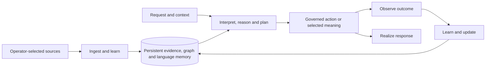

# SCCE — Self-Contained Cognitive Engine

SCCE is a local cognitive engine for material selected by its operator. It takes source material through ingestion and learning into persistent evidence, a cognitive graph, and language memory. At runtime it interprets requests, reasons over the available state, plans governed actions, realizes responses, and can learn from recorded outcomes.

PostgreSQL is the canonical local store. Source identity and evidence spans are retained alongside learned structures. Language memory is learned from the selected source material; language coverage and output quality depend on the trained data and require separate evaluation. SCCE is not based on English-only hand-authored conversational rules.

Evidence and proof are distinct. Source-backed factual claims require admissible evidence; proof or certification metadata is attached where the relevant operation produces it. Proof is not a blanket precondition for every conversational or creative response, and language memory does not establish factual truth.

## Start locally

[QUICKSTART.md](QUICKSTART.md) describes local setup, PostgreSQL configuration, a bounded first corpus, and running the local runtime. [Corpus training](docs/CORPUS_TRAINING.md) documents supported inputs, bounds, lifecycle behavior, and the detailed compilation pipeline. The CLI and server operate on the same local PostgreSQL-backed brain; source acquisition, ingestion, training, and turn processing are not hosted services.

Hosting is deferred. The current product path is local operation, with the operator choosing material and approving governed actions. No hosted per-turn compute or prebuilt giant brain is part of this release boundary.

## Qualification status

SCCE's architecture and available checks do not establish general commercial readiness. The useful user-built initial brain within an 8 GB whole-machine limit, restartable serving, multilingual quality, and learned-speech quality remain open qualification work. The [build plan](docs/INGESTION_BRAIN_BUILD_PLAN.md) defines the acceptance scope; the [recovery audit](docs/INGESTION_RECOVERY_AUDIT.md) records measured results and limits. The [acceptance suite](docs/ACCEPTANCE_SUITE.md), [ablation report](docs/ABLATION.md), and [evaluation index](docs/README.md#evidence-and-evaluation) link capability-specific evidence and its revision scope.

## Repository

- `packages/kernel` — local reasoning, evidence admission, planning, realization, and learning
- `packages/adapters-node` — PostgreSQL persistence and local source/runtime adapters
- `packages/server` — local HTTP API and workbench runtime
- `packages/ui` — browser workbench
- `packages/cli` — command-line ingestion, training, and operations
- `packages/vscode` — reviewed local workspace actions
- `docs/` — operating contracts, architecture, qualification plans, and evidence indexes

The source repository is available for inspection. Commercial use requires a separate agreement; see [COMMERCIAL.md](COMMERCIAL.md) and [LICENSE](LICENSE).
