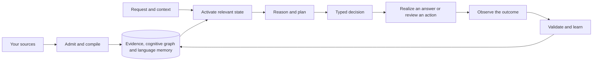

# SCCE — Self-Contained Cognitive Engine

SCCE is a local cognitive engine that turns material chosen by its operator into persistent evidence, structured knowledge, and language memory. It uses that state to interpret requests, reason over evidence, plan and carry out governed actions, express results, and learn from recorded outcomes.

The graph retains participant roles, qualifiers, time and provenance. Bounded cognitive operators work over the relevant state, and explicit plans connect reasoning to responses and actions. Language memory supplies learned constructions and wording; corrections and observed outcomes update persistent state. That complete loop is the engine's organizing principle.

The same local engine owns ingestion, durable state, turns, and learning. Its reasoning and language pipeline runs locally without an LLM or hosted inference service. Source evidence keeps its identity and location; language memory is learned from admitted material. Optional perception components are listed in [the model declaration](models.declared.json).

## Try the local workflow

[QUICKSTART.md](QUICKSTART.md) covers local setup. The operator selects bounded source material, ingests and trains it into the local PostgreSQL store, inspects the resulting evidence and structures, then runs requests through the existing local runtime. The owner controls what sources are acquired and which proposed actions are approved.

The static workbench packages as ordinary web assets for Cloudflare Pages Free. The browser connects to a loopback SCCE server; PostgreSQL, acquisition, training, and request processing stay on the operator's device. The page cannot browse local files on its own. The operator supplies a pinned public GitHub source or uses the documented local runtime path. See [Static Pages workbench](packages/ui/STATIC_PAGES.md) for the exact origin allowlist, bearer-token, and local-server requirements. The static artifact is verified; the Pages-hosted browser to live local-runtime connection still awaits integration verification. This is a UI, not a hosted brain or serverless turn service.

## Current qualification

The useful 8 GB initial brain, restartable serving and learned-speech gates remain open. The [build plan](docs/INGESTION_BRAIN_BUILD_PLAN.md) defines acceptance; the [recovery audit](docs/INGESTION_RECOVERY_AUDIT.md) records measured results. See the [acceptance suite](docs/ACCEPTANCE_SUITE.md), [ablation report](docs/ABLATION.md) and [evaluation index](docs/README.md#evidence-and-evaluation) for capability-specific evidence, with the revision and scope of each result.

## Repository

- `packages/kernel` — local reasoning, evidence admission, planning, realization, and learning
- `packages/adapters-node` — PostgreSQL persistence and local source/runtime adapters
- `packages/server` — local HTTP API and workbench runtime
- `packages/ui` — browser workbench, including the static Pages shell
- `packages/cli` — command-line ingestion, training, and operations
- `packages/vscode` — reviewed local workspace actions
- `docs/` — operating contracts, architecture, qualification plans, and evidence indexes

The PostgreSQL-backed data model is canonical. The source repository is available for inspection; commercial use requires a separate agreement. See [COMMERCIAL.md](COMMERCIAL.md) and [LICENSE](LICENSE).
