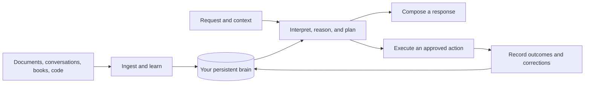

# SCCE — Self-Contained Cognitive Engine

**Build a brain from your knowledge. Run it on your own machine. Keep what it learns.**

SCCE turns documents, conversations, books, and source code into persistent cognitive structure. It learns language and program patterns, connects knowledge in a graph, and brings reasoning, planning, response composition, and local actions into one runtime.

Your material becomes persistent memory the engine can work with. Add sources, ask questions, explore connections, work on a project, and carry the learned state into the next session.

The engine runs on your CPU, with PostgreSQL holding durable memory. Local operation has no per-token inference bill and requires no external model API or GPU.

## Your knowledge, working together

| Bring to SCCE | Put it to work |
|---|---|
| Documents, reference material, and books | Ask about their contents, follow relationships, and inspect the supporting passages. |
| Conversations and language examples | Build language memory and reusable structures for interpreting requests and composing responses. |
| Source code, documentation, and examples | Inspect workspaces, propose source-derived repairs, and validate changes through compilers and configured tests. |
| Corrections and recorded outcomes | Retain feedback and execution history alongside the knowledge that informed the work. |

Use the browser workbench, command line, local HTTP API, or VS Code integration against the same PostgreSQL-backed brain.

## How SCCE works

SCCE learns and operates on an explicit cognitive structure. Ingestion preserves source identity and builds evidence, graph relationships, language profiles, and learned patterns. A request activates relevant knowledge; the runtime reasons over it, selects meaning or an action plan, and composes a response through the shared language system.



**Language and knowledge develop together.** A shared Unicode-based learning pipeline captures forms and structures from the material you provide. Language profiles, relationships, and program patterns remain connected to their sources.

**Memory survives the session.** Sources, learned structures, conversation state, and recorded outcomes live in the local store. Restarting the runtime reopens that brain.

**Reasoning follows relationships.** The runtime activates relevant graph neighborhoods and learned artifacts to connect a request with the knowledge and actions it needs.

**Actions close the loop.** Planning, reviewed workspace changes, validation, and recorded outcomes connect the engine's decisions with what happened afterward.

## Inspect the work when you need to

The workbench lets you explore sources, evidence, traces, settings, and action approvals. For code changes, verification receipts show which compiler and project checks ran. Source links and proof metadata accompany the operations that produce them; conversation and creative composition use their own learned structures.

## Start locally

You need Node.js 24.18 or later within the 24.x line, pnpm, and PostgreSQL.

```sh
pnpm install
pnpm build
```

Follow the [quickstart](QUICKSTART.md) to configure your local database, teach the engine your first collection, and start the workbench at `http://127.0.0.1:3873/`.

- [User guide](docs/USER_GUIDE.md) — work with the brain, inspect answers, and manage local operations.
- [Corpus training](docs/CORPUS_TRAINING.md) — bring in documents, books, conversations, and code.
- [Workspace runtime](docs/WORKSPACE_RUNTIME.md) — inspect projects and use reviewed local actions.
- [Code lane](docs/CODE_LANE.md) — learned repair, compiler integration, and project validation.
- [Architecture](docs/ARCHITECTURE.md) — the cognitive pipeline, package boundaries, and persistence model.
- [Engineering and evaluation](docs/README.md) — implementation references, reproducible checks, benchmarks, and development plans.

## Explore the repository

| Package | Responsibility |
|---|---|
| `packages/kernel` | Reasoning, learning, planning, language, and cognitive contracts |
| `packages/adapters-node` | PostgreSQL persistence, ingestion, and local runtime adapters |
| `packages/server` | Local HTTP API and workbench server |
| `packages/ui` | Browser workbench |
| `packages/cli` | Ingestion, training, inspection, and operations |
| `packages/vscode` | Reviewed workspace integration |

[Commercial licensing](COMMERCIAL.md) · [Source terms](LICENSE) · [Security](SECURITY.md)
